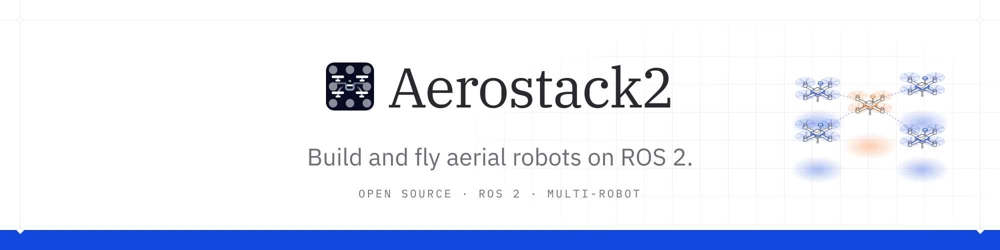

<p align="center">
  <a href="https://aerostack2.org">
    <picture>
      <source media="(prefers-color-scheme: dark)" srcset=".github/assets/banner-dark.png">
      
    </picture>
  </a>
</p>

<p align="center">
  <a href="https://github.com/aerostack2/aerostack2/actions/workflows/ci.yaml"></a>
  <a href="https://app.codecov.io/gh/aerostack2/aerostack2"></a>
  <a href="https://docs.ros.org/en/humble/"></a>
  <a href="https://docs.ros.org/en/jazzy/"></a>
  <a href="https://pixi.sh"></a>
  <a href="https://arxiv.org/abs/2303.18237"></a>
  <a href="LICENSE"></a>
</p>

<p align="center">
  <a href="https://aerostack2.org">Website</a> ·
  <a href="https://github.com/aerostack2/aerostack2/discussions">Discussions</a> ·
  <a href="https://github.com/aerostack2/aerostack2/issues">Issues</a>
</p>

Aerostack2 is an open source framework for developing multi-robot aerial systems, built on ROS 2.

- **ROS 2 native.** Every component is a ROS 2 node with standard topics, services and actions.
- **Modular.** Controllers, state estimators, behaviors and planners are plugins you can swap without touching the rest of the stack.
- **Platform independent.** The same mission runs in simulation and on real aircraft, so moving from sim to real is a configuration change.
- **Behavior based.** Missions are built from reusable behaviors, driven from Python or behavior trees.
- **Swarm ready.** Multi-drone namespacing and coordination are part of the design, not an add-on.

https://github.com/user-attachments/assets/f0dcbd75-bcbb-4bd8-a168-14ee1f9b1481

## Getting started

Follow the [installation guide](https://aerostack2.org/docs/getting-started/installation), then the [quickstart](https://aerostack2.org/docs/getting-started/quickstart) for a first flight.

## Contributing

Contributions are welcome. Read [CONTRIBUTING.md](CONTRIBUTING.md) and the [Code of Conduct](CODE_OF_CONDUCT.md), then open an [issue](https://github.com/aerostack2/aerostack2/issues) or a pull request. New features start with an issue, not a pull request.

## Citation

If you use Aerostack2 in academic work, please cite:

```bibtex
@article{fernandez2023aerostack2,
  title   = {Aerostack2: A Software Framework for Developing Multi-robot Aerial Systems},
  author  = {Fernandez-Cortizas, Miguel and Molina, Martin and Arias-Perez, Pedro and Perez-Segui, Rafael and Perez-Saura, David and Campoy, Pascual},
  journal = {arXiv preprint arXiv:2303.18237},
  year    = {2023}
}
```

## License

Aerostack2 is released under the [BSD 3-Clause License](LICENSE).
