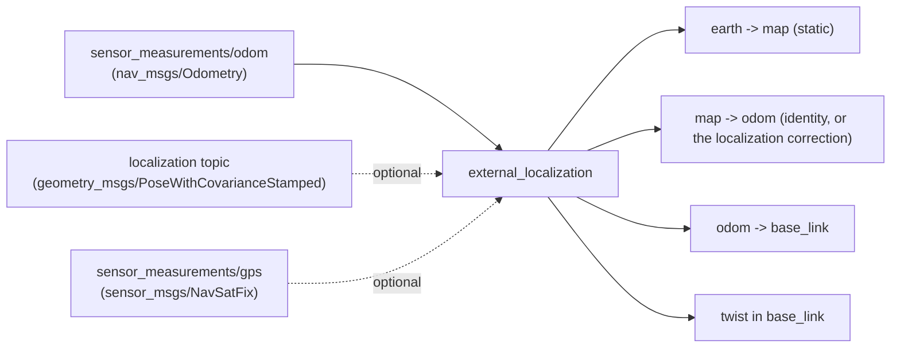

# external_localization

State estimator plugin that publishes estimates computed outside aerostack2: an odometry
that the platform or a sensor stack already computes, optionally corrected by an external
localizer, and optionally anchored to a GPS datum.

Use it when the estimation happens elsewhere: PX4, DJI, a Crazyflie flow deck, a visual or
lidar odometry, and on top of it a SLAM or relocalization system that knows where the drone
is in a map.

It replaces `raw_odometry`, which is now a deprecated alias of this plugin (see
[Migrating from raw_odometry](#migrating-from-raw_odometry)).

## How it works

Two inputs, following [REP-105](https://ros.org/reps/rep-0105.html):

- **Odometry** is smooth but drifts. It is published as `odom -> base_link`, and its twist
  as the body velocity.
- **Localization** is drift-free but can jump. It is optional, and corrects the drift
  through `map -> odom`.



Without a localization topic, `map -> odom` is a static identity and the plugin forwards
what it is given.

The frame ids on the incoming message are not trusted: if `header.frame_id` is not the odom
frame or `child_frame_id` is not the base frame, the plugin warns once and overrides them.

Where `earth -> map` comes from depends on the configuration:

| `use_gps` | `set_earth_map` | `earth -> map` |
| --- | --- | --- |
| `false` | `false` | Identity. `map` and `earth` coincide |
| `false` | `true` | The pose in `earth_map_transform` |
| `true` | `false` | Placed at the first GPS fix, expressed relative to the datum |
| `true` | `true` | The pose in `earth_map_transform`. GPS only supplies the datum |

## Parameters

All parameters live under the `external_localization:` block. Defaults in
[`config/plugin_default.yaml`](config/plugin_default.yaml).

| Parameter | Type | Default | Description |
| --- | --- | --- | --- |
| `odometry.topic` | string | `sensor_measurements/odom` | Odometry input |
| `localization.topic` | string | `""` | Localization input. Empty means odometry only |
| `localization.odometry_history` | double | `1.0` | Seconds of odometry kept to match late poses |
| `localization.timeout` | double | `1.0` | Seconds without a pose before logging an error |
| `localization.wait_for_localization` | bool | `true` | Hold `self_localization` until the first pose |
| `localization.jump.mode` | string | `none` | `none`, `clamp` or `smooth` |
| `localization.jump.max_rate.translation` | double | `0.5` | m/s, `clamp` only |
| `localization.jump.max_rate.rotation` | double | `0.3` | rad/s, `clamp` only |
| `localization.jump.smoothing_time` | double | `1.0` | Time constant in seconds, `smooth` only |
| `localization.jump.warn_translation` | double | `1.0` | Warn on corrections larger than this, metres |
| `earth_map_transform.set_earth_map` | bool | `false` | Pin `earth -> map` from parameters instead of letting it be derived |
| `earth_map_transform.position.{x,y,z}` | double | `0.0` | Position of `map` in `earth`, metres |
| `earth_map_transform.orientation.{roll,pitch,yaw}` | double | `0.0` | Orientation of `map` in `earth`, radians |
| `use_gps` | bool | `false` | Anchor `earth` at a geodetic datum |
| `gps_origin.set_origin` | string | `first_gps` | Where the datum comes from: `first_gps`, `manual` or `service` |
| `gps_origin.coordinates.latitude` | double | `0.0` | Datum latitude, degrees (WGS84) |
| `gps_origin.coordinates.longitude` | double | `0.0` | Datum longitude, degrees |
| `gps_origin.coordinates.altitude` | double | `0.0` | Datum altitude, metres, same convention as the fixes |

Minimal configuration:

```yaml
/**:
  ros__parameters:
    plugin_name: "external_localization"
    external_localization:
      odometry:
        topic: "sensor_measurements/odom"
```

## Localization

Set `localization.topic` to the pose of `base_link` that your localizer publishes, as a
`geometry_msgs/PoseWithCovarianceStamped` in the namespaced `map` frame (`drone0/map`) or in
`earth`. Each pose sets `map -> odom` to the pose times the inverse of the odometry at the
pose's timestamp, so odometry keeps the published pose smooth and the localization removes
its drift.

```yaml
external_localization:
  odometry:
    topic: "sensor_measurements/odom"
  localization:
    topic: "localization/pose"
```

**Your localizer must not publish `map -> odom` itself.** Most do by default, and two
publishers of the same transform fight each other. Turn it off and feed this plugin its pose
topic instead:

| Localizer | Pose topic | Turn off its transform with |
| --- | --- | --- |
| `nav2_amcl` | `amcl_pose` | `tf_broadcast: false` |
| `slam_toolbox` | `pose` | `transform_publish_period: 0.0` |

The pose must use aerostack2's frame ids. A pose in any other frame, such as an
un-namespaced `map`, is dropped with an error naming the expected frames.

### Timing

Localizers usually publish late: a pose describes where the drone was when the scan or
keyframe was taken. The plugin keeps `odometry_history` seconds of odometry and matches each
pose against the odometry at its own timestamp. A pose older than the history is dropped
with a warning that says how late it was. Raise `odometry_history` for slow localizers.

### Before the first pose

With `wait_for_localization: true` (the default), nothing is published as `self_localization`
until the first pose arrives, so the drone never takes off assuming its starting point is the
map origin. Localizers that need the drone to move before they produce a pose need `false`:
`map -> odom` is then identity until the first pose, and the drone flies on odometry alone.

### When localization stops

The last `map -> odom` is kept and an error is logged once `timeout` seconds pass without a
pose. Odometry keeps the pose moving, so only the drift correction freezes, and the error
grows at the odometry's drift rate.

### Jumps

aerostack2 controllers follow the pose in `earth`, so a large correction, such as a loop
closure, reaches the drone as a step in its position. `jump.mode` decides how a correction
reaches `map -> odom`:

| Mode | Behaviour |
| --- | --- |
| `none` | Applied at once, as `nav2_amcl` and `slam_toolbox` do |
| `clamp` | `map -> odom` moves toward the correction at most `max_rate` |
| `smooth` | `map -> odom` blends toward the correction with time constant `smoothing_time` |

Corrections larger than `warn_translation` are logged in every mode.

## Migrating from raw_odometry

`raw_odometry` still loads, reads its existing `raw_odometry:` block and logs a deprecation
warning. It will be removed in a future release. To migrate, rename the plugin and the
block, and move `odom_sub_topic` to `odometry.topic`:

```yaml
# before
plugin_name: "raw_odometry"
raw_odometry:
  odom_sub_topic: "sensor_measurements/odom"

# after
plugin_name: "external_localization"
external_localization:
  odometry:
    topic: "sensor_measurements/odom"
```

## GPS

`use_gps: true` gives the tree a **geodetic datum**: a latitude/longitude/altitude that the
`earth` frame origin sits on. Everything downstream stays in metres, but now those metres
mean something on the planet, which is what lets a mission be written in GPS coordinates
and what `get_origin` reports to the rest of the stack.

Enabling it adds:

| Interface | Type | Purpose |
| --- | --- | --- |
| `sensor_measurements/gps` | `sensor_msgs/NavSatFix` | Input. Only the **first** fix is read, then the subscription is dropped |
| `set_origin` | `as2_msgs/srv/SetOrigin` | Supply the datum at runtime |
| `get_origin` | `as2_msgs/srv/GetOrigin` | Query the datum |

### The three `set_origin` modes

| Mode | Datum comes from | Use it when |
| --- | --- | --- |
| `first_gps` | The first fix received | Normal outdoor flight. Take off from wherever you are and treat that point as the origin |
| `manual` | `gps_origin.coordinates` | Repeated flights over the same site, or multiple drones that must share one origin so their local coordinates agree |
| `service` | A `set_origin` call | Something else, a ground station or a mission script, decides the origin at runtime |

In `manual` and `service` modes the first fix is still needed, but only to compute *where
the drone is* relative to the datum. In `service` mode that fix is held aside until the
call arrives.

**The datum can only be set once.** Whichever source wins, later `set_origin` calls are
refused with `success: false`. `get_origin` always answers once a datum exists.

> :warning: **In `service` mode the TF tree stays incomplete until `set_origin` is
> called.** `earth -> map` is not published before that, so nothing downstream can resolve
> a pose. This is intentional and matches the historical behaviour, but a misconfigured
> `service` mode looks exactly like a hung estimator. The startup log says so explicitly.

An unrecognised value for `set_origin` logs a warning and falls back to `first_gps`.

### Examples

Take the origin from the first fix:

```yaml
external_localization:
  use_gps: true
  gps_origin:
    set_origin: "first_gps"
    coordinates: {latitude: 0.0, longitude: 0.0, altitude: 0.0}
```

Fixed site origin, shared between flights and between drones:

```yaml
external_localization:
  use_gps: true
  gps_origin:
    set_origin: "manual"
    coordinates:
      latitude: 40.4378698
      longitude: -3.8196207
      altitude: 660.0
```

Fixed site origin *and* a known starting position inside it. `earth_map_transform` places
`map`, GPS supplies the datum:

```yaml
external_localization:
  use_gps: true
  earth_map_transform:
    set_earth_map: true
    position: {x: 10.0, y: -5.0, z: 0.0}
    orientation: {roll: 0.0, pitch: 0.0, yaw: 1.5708}
  gps_origin:
    set_origin: "manual"
    coordinates: {latitude: 40.4378698, longitude: -3.8196207, altitude: 660.0}
```

Wait for a ground station to set the origin:

```yaml
external_localization:
  use_gps: true
  gps_origin:
    set_origin: "service"
    coordinates: {latitude: 0.0, longitude: 0.0, altitude: 0.0}
```

```bash
ros2 service call /drone0/set_origin as2_msgs/srv/SetOrigin \
  "{origin: {latitude: 40.4378698, longitude: -3.8196207, altitude: 660.0}}"
```

> Every key must be present in the YAML even when the mode does not use it. Parameters are
> declared without defaults, so a missing `coordinates` block is fatal regardless of the
> mode. This is why the examples above always carry the full block.

## Notes

- Without a localization topic, any drift in the platform's odometry propagates straight
  through to the published pose. If you need to fuse sensors rather than take an external
  estimate, use [`simple_ekf`](../simple_ekf/README.md).
- The plugin claims all four transform types.
- The GPS subscription is dropped after the first fix. The plugin never re-reads GPS, so a
  changing fix cannot move the tree.
